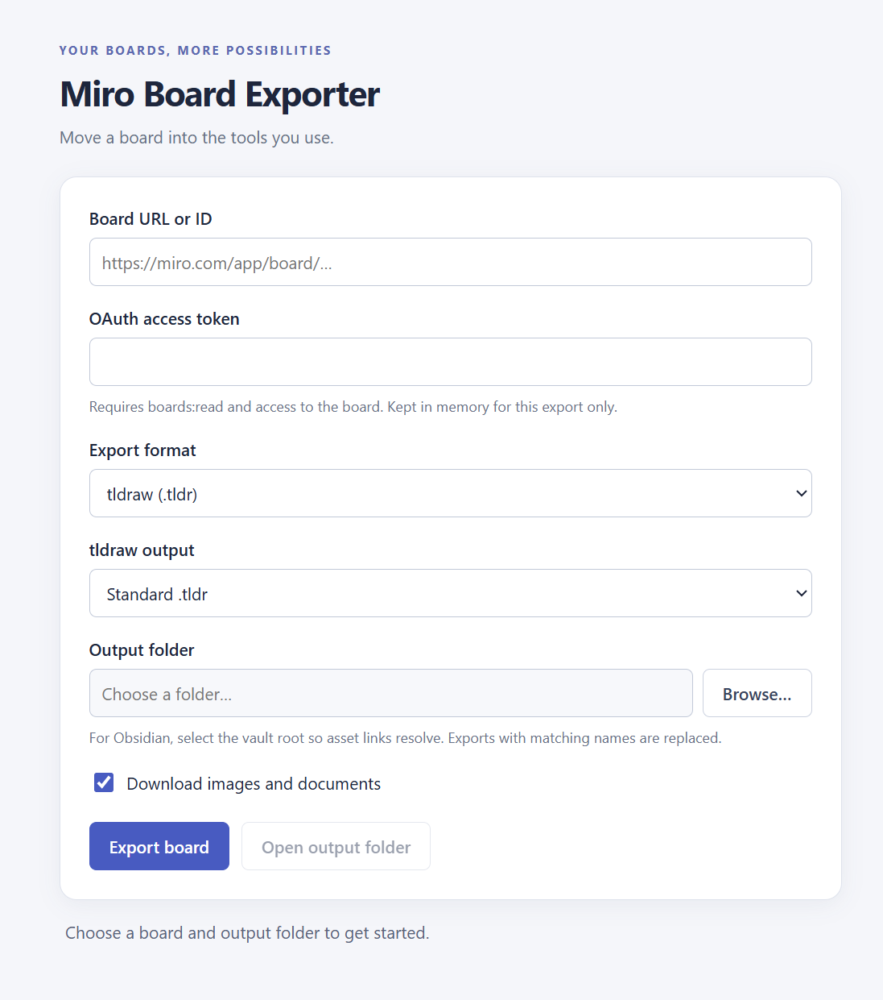

# Miro Board Exporter

Export Miro boards to tldraw (`.tldr`) with a Windows desktop app.
Obsidian Canvas, draw.io, Markdown, and Obsidian's tldraw format are also available.

This fork adds a Windows graphical interface to
[essoen's Miro board exporter](https://github.com/essoen/miroboard-export-tool)

**[Download for Windows (64-bit)](https://github.com/SabulineHorizon/miroboard-export-tool/releases/download/gui-v0.1.0/Miro-Board-Exporter-0.1.0-portable.exe)**
· [Releases](https://github.com/SabulineHorizon/miroboard-export-tool/releases)

## Quick start

1. Download and open **Miro-Board-Exporter-0.1.0-portable.exe**.
2. Paste your Miro board's URL into **Board URL or ID**.
3. Paste a [Miro access token](#get-a-miro-access-token) into **OAuth access token**.
4. Leave **Export format** set to **tldraw (.tldr)** and **tldraw output** set to
   **Standard .tldr**.
5. Click **Browse…** to choose an output folder, then **Export board**.
6. When the export finishes, click **Open output folder** and open the `.tldr`
   file in [tldraw](https://tldraw.com).

Matching filenames are overwritten. Use a new folder to keep an earlier export.

## Get a Miro access token

The exporter needs an access token with **`boards:read`** permission for your
board's team.

1. In Miro, go to **Settings → Your apps** and create an app. Miro may first ask
   you to create a Developer team.
2. In the app settings, enable **`boards:read`** and save.
3. Choose **Install app and get OAuth token**, select your board's team, and
   authorize the app. Copy the access token.

[Miro's setup guide](https://developers.miro.com/docs/rest-api-build-your-first-hello-world-app)
includes screenshots. If your organization restricts app installation, contact
its Miro administrator.

Keep your token private. The exporter does not save it; paste it again for each
export.

## Export formats

The maintainer has tested **standard `.tldr` export**. The other formats are
inherited from the original project and have not been manually tested in this
fork.

| Format | Output | Open with |
| --- | --- | --- |
| tldraw → Standard .tldr | `.tldr` | tldraw |
| Obsidian Canvas | `.canvas` | Obsidian |
| tldraw → Obsidian .tldraw.md | `.tldraw.md` | Obsidian's [tldraw plugin](https://github.com/holxsam/tldraw-in-obsidian) |
| draw.io | `.drawio` | draw.io / diagrams.net |
| Markdown | `.md` notes and a board index in `miro-notes/` | A Markdown editor |

For Obsidian exports, select your vault's main folder as the output folder.
Downloaded images and documents are saved in `assets/`; keep that folder with
exports that reference it.

## Limitations

- Conversion can change the layout or omit unsupported Miro content. Review any
  export warnings and check the result in your destination app.
- Standard `.tldr` files use remote image links, even with **Download images and
  documents** selected. Images may require Miro access and may not work offline.
- An interrupted or failed export can leave incomplete files.

## Troubleshooting

| Problem | What to try |
| --- | --- |
| Token rejected | Get a new token and paste it again. |
| Access denied or board not found | Check the board URL, the token's `boards:read` permission, and access to the board's team. |
| Rate limit reached | Wait before retrying. |
| Cannot write files | Choose a writable output folder and check available disk space. |
| Missing images | Standard `.tldr` uses remote links that may require Miro access or expire. For other formats, keep the `assets/` folder with the export. |
| Windows shows an unrecognized-app warning | The executable is unsigned. Check that you downloaded it from this repository's release page. |

To [report a problem](https://github.com/SabulineHorizon/miroboard-export-tool/issues),
include your app version, export format, and steps to reproduce it. Remove tokens
and private board content from screenshots or examples.

## Development and credits

See the [development guide](docs/DEVELOPMENT.md) for building from source, CLI
usage, and testing.

Forked from [essoen/miroboard-export-tool](https://github.com/essoen/miroboard-export-tool),
which provides the original CLI, Miro extraction, and format generators.

This fork's Windows GUI and accompanying changes were developed using OpenAI
Codex under the maintainer's direction.

## License

This project is licensed under the [MIT License](LICENSE), which permits reuse,
modification, and redistribution, including commercial use, provided its
copyright and license notices are retained. Third-party components retain their
own licenses; see [third-party notices](THIRD_PARTY_NOTICES.txt).
